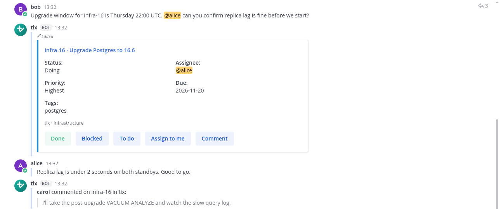
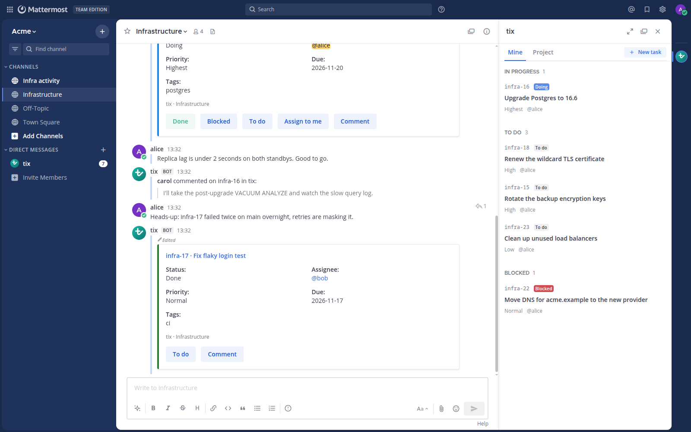
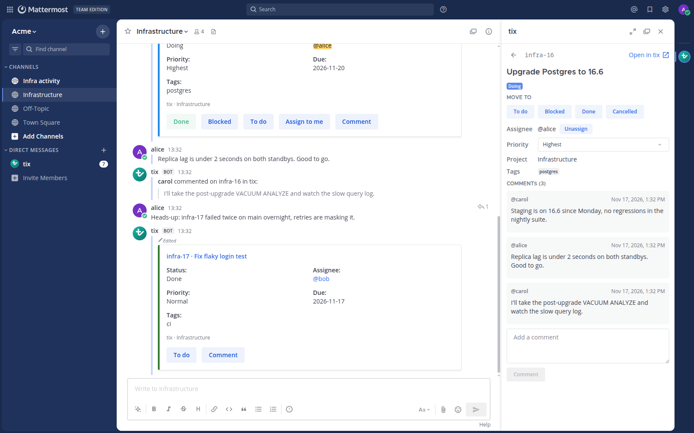
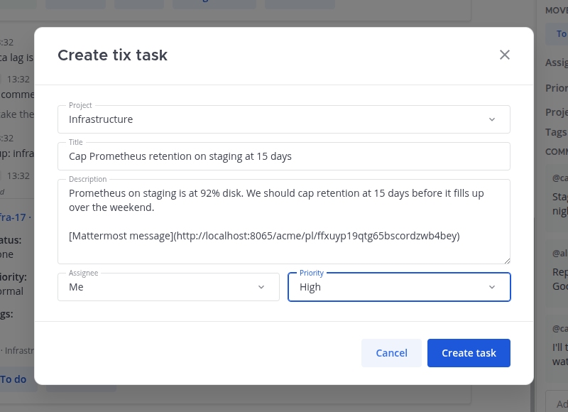
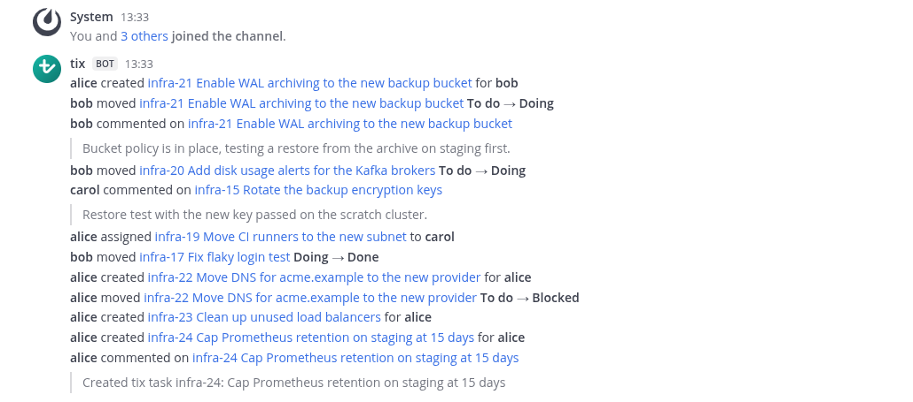
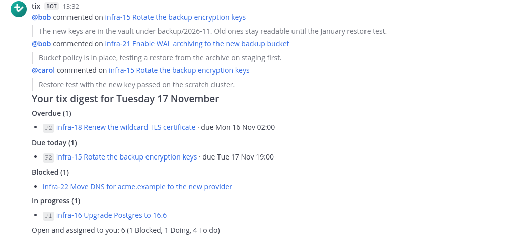

# tix for Mattermost

[](https://github.com/heliopsy/mattermost-plugin-tix/actions/workflows/ci.yml)
[](https://github.com/heliopsy/mattermost-plugin-tix/actions/workflows/e2e.yml)
[](https://github.com/heliopsy/mattermost-plugin-tix/releases/latest)
[](LICENSE)

Work your [tix](https://github.com/heliopsy/tix) tasks without leaving the conversation. Create a task from a
message, move it along its workflow from a card in the thread, get told when something needs you, and keep a
channel up to date with a project's activity.

Everything happens **as you**: each person links their own tix account, so tix records who did what and decides
what they may see and change.



## What it does

- **Task cards.** Mention `infra-42` in a message and the tix bot answers in the thread with a card: status,
  assignee, priority, due date, and buttons for the next states, *Assign to me* and *Comment*. Cards redraw
  live when the task changes, wherever they are. [More](docs/cards.md)
- **Slash commands.** `/tix new`, `show`, `list`, `search`, `mine`, `due`, `start`, `done`, `close`, `reopen`,
  `move`, `comment`, `assign`, with autocomplete for references, projects and states, and tix's quick-add syntax
  (`/tix new infra Fix backups !high #ops @bob due:fri`). [More](docs/commands.md)
- **Create from a message.** *Create tix task* in any message's menu, or react with :ticket: to file it in the
  channel's default project.
- **A tix sidebar.** Your open tasks by status, any project's tasks, a task view with transitions and comments,
  and a create dialog. [More](docs/app.md)
- **Channel feeds.** `/tix subscribe infra` posts what happens in a project: created, moved, assigned,
  commented. [More](docs/notifications.md)
- **Your language, your format.** English and Bulgarian, following each person's Mattermost language, and
  settings for feed detail, comment text, card fields and buttons, date format, digest sections and the bot's
  name and icon. [More](docs/setup.md#configure)
- **Personal DMs.** When you are assigned, mentioned, or someone comments on your task. Never about your own
  actions.
- **Thread sync.** With `/tix sync on`, replies under a card become tix comments, and tix comments come back
  into the thread.
- **Digest and reminders.** A morning summary of what is overdue, due, blocked and in progress, in your time
  zone, and one reminder when a task is due or overdue. [More](docs/digest.md)

| Sidebar | Task | Create from a message |
| --- | --- | --- |
|  |  |  |

| Channel feed | Daily digest |
| --- | --- |
|  |  |

## Quick start

1. Install the [latest release](https://github.com/heliopsy/mattermost-plugin-tix/releases/latest) on
   Mattermost 11.7 or later (System Console > Plugins > Plugin Management, or `mmctl plugin install-url`).
2. In **System Console > Plugins > tix**, set the **tix server URL** and an **admin token** (the scopes it needs
   are in [setup](docs/setup.md)).
3. Run `/tix webhook setup` as a system admin, so changes in tix reach Mattermost.
4. Everyone runs `/tix connect` once. The plugin matches their verified email to their tix account and issues
   them a token of their own; nothing to copy or paste.

Then try `/tix new <project> <title>`, mention the task in a message, or open the tix sidebar from the channel
header. Full guide: **[docs/setup.md](docs/setup.md)**.

## Commands at a glance

| | |
| --- | --- |
| Account | `/tix connect`, `me`, `disconnect`, `notifications on\|off`, `digest`, `reminders` |
| Tasks | `/tix new`, `show`, `list`, `search`, `mine`, `due`, `start`, `done`, `close`, `reopen`, `move`, `comment`, `assign` |
| Channels (admins) | `/tix subscribe`, `unsubscribe`, `subscriptions`, `sync on\|off`, `channel project` |
| System (admins) | `/tix webhook setup\|status\|remove` |

`/tix help` lists them in Mattermost; [docs/commands.md](docs/commands.md) has every option.

## Privacy

Every action runs with the acting person's own token, and a card only shows a task its message's author can see.
Channel feeds and thread sync publish task titles and comments to everyone in the channel; only channel admins
can turn them on, and the plugin says so when they do. Tokens are stored encrypted and never logged. See
[setup](docs/setup.md#permissions-and-privacy).

## Development

Go, Node, golangci-lint and Python versions are pinned in [`.tool-versions`](.tool-versions).

```bash
make dist     # build the bundle
make e2e      # run it in a real Mattermost against a real tix, in podman
```

[docs/development.md](docs/development.md) covers the checks, the end-to-end suite, the code layout and
releasing. Behaviour is specified in [`openspec/specs/`](openspec/specs/). Contributions:
[CONTRIBUTING.md](CONTRIBUTING.md). Security reports: [SECURITY.md](SECURITY.md).

## License

[AGPL-3.0](LICENSE). The build tooling derives from Mattermost's plugin starter template (Apache-2.0); see
[NOTICE](NOTICE).
